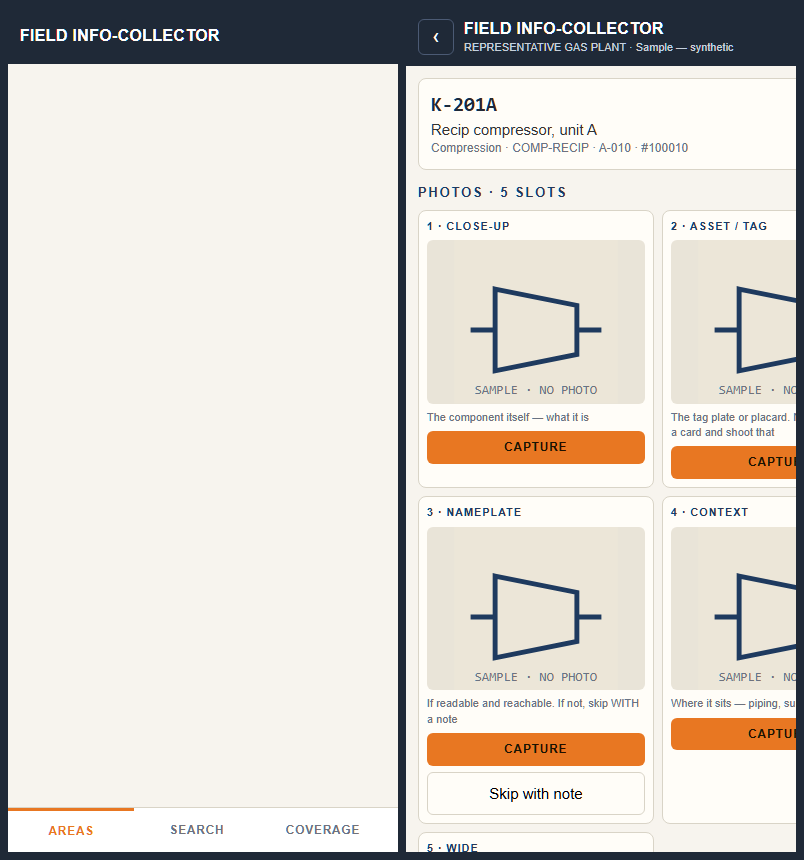

# Field Info-Collector

**Schema-based picture and data collection, configured for bespoke deployment.** Runs on a phone with
no backend, no account and no install step. One configuration file says what to collect; the app
collects it; one zip comes out the other end.



Built by [Specialized Projects Group](https://www.specializedprojectsgroup.com). This is the
sample-sized version of the tool we run on plant walkdowns and asset assessments: same idea, nothing
shared, so it can be free. The full version adds a shared backend, multi-user review and the pipeline
that turns captures into load files for a maintenance system.
[That is what the Teardown is for.](https://www.specializedprojectsgroup.com/teardown)

## The idea

Every assessment is the same job wearing different clothes: stand in front of a thing, photograph
it the same way every time, record the same handful of facts, move to the next thing, and know at
the end what you missed. A plant after a turnaround, a ship in a lay-up berth, a substation, a
fleet of skids. The **schema** is what changes. The app should not.

So the whole deployment is one file, `seed.js` (or an imported JSON of the same shape):

| Section | What it holds |
|---|---|
| `schema.slots` | the photo slots per asset: label, hint, whether it may be skipped with a note |
| `schema.fields` | the data fields per asset: `text`, `number`, `select` (with options), `check`; `required` ones count toward COLLECTED |
| `areas` | the areas of the register |
| `assets` | the register: id, area, tag, description, class, asset number, and a `kind` for the placeholder drawing |

Change the schema and the app renders the new slots and fields. No code changes.

## What it does

- **Areas → assets → capture.** Status per asset: GAP, PARTIAL, COLLECTED. Rolled up per area.
- **Photos** are downscaled on the phone so a 200-asset walk is not 2 GB. A skippable slot can be
  skipped only with a note.
- **Data fields** save as you type, on the device.
- **Coverage report** read from the register, not the captures: missing class, missing description,
  duplicate tags, rows with no asset number. These are the rows that fail at load time, long after
  someone approved them.
- **Export one zip:** `photos/<assetid>_<slot>.jpg`, `manifest.csv` with status and every data
  field per asset, `coverage.csv`, and `config.json`, the configuration that produced them.
- **Offline.** A service worker caches the shell; records live in IndexedDB on the device.

## Run

It is static. Any web server works, including GitHub Pages or a folder on a laptop:

```
python -m http.server 8080
```

Open `http://<laptop-ip>:8080` on the phone and add it to the home screen. The camera input needs
HTTPS or localhost on most phones; any static host with a certificate solves that.

## A bespoke deployment

Copy `seed.js`, change the schema and the register, deploy the folder. Or keep the app as is and
use Menu → Import on the phone with a JSON file of the same shape:

```json
{ "meta":   { "facility": "YOUR SITE", "label": "assessment 1", "version": "1" },
  "schema": { "slots":  [ { "k": 1, "label": "Close-up" }, { "k": 2, "label": "Nameplate", "skippable": true } ],
              "fields": [ { "k": "condition", "label": "Condition", "type": "select", "options": ["Serviceable", "Not serviceable"], "required": true },
                          { "k": "notes", "label": "Notes", "type": "text" } ] },
  "areas":  { "ER": "Engine room" },
  "assets": [ { "id": "A-010", "area": "ER", "tag": "K-201A", "desc": "Recip compressor", "cls": "COMP-RECIP", "num": "100010", "kind": "compressor" } ] }
```

`kind` only picks the schematic placeholder shown before a photo exists: vessel, pump, compressor,
motor, exchanger, xmtr, psv, valve, meter, analyzer, panel.

## Sample data

The sample register is a synthetic gas plant with defects planted so the coverage report has
something to say. It ships with **drawn placeholders, not photographs**, on purpose: a sample should
belong to nobody. `SAMPLE_PHOTOS.md` has one prompt per equipment type if you want photographs in a
demo; drop them into `photos/` named `<assetid>_<slot>.jpg`.

## What this is not

No sync, no users, no review step, no load-file generation. Those are the parts that need a backend
and a method, which is the paid version. This one is for a single phone and an honest look at a
register.

MIT. Specialized Projects Group, Inc.
